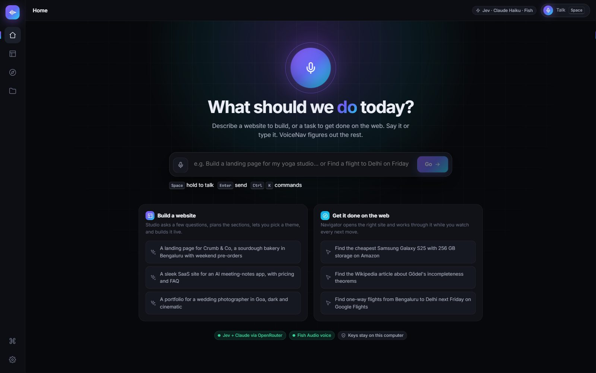
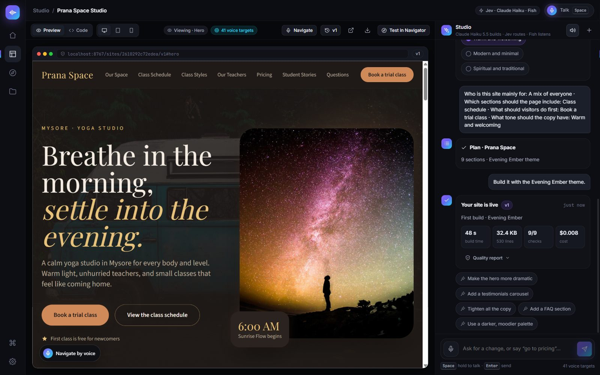
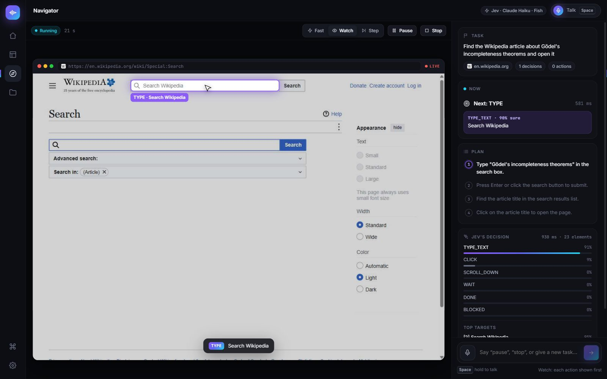
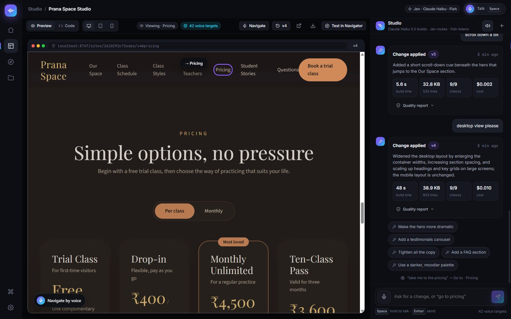
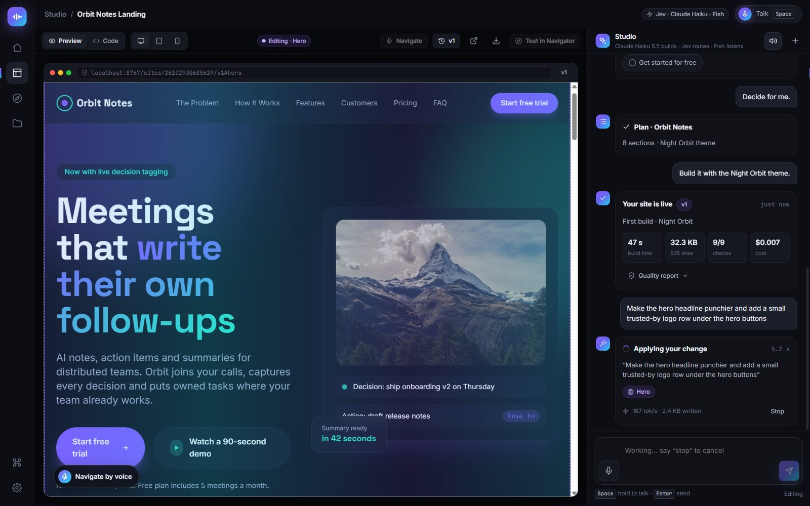

# VoiceNav 🎙️

**Say what you want. VoiceNav builds the website, or gets the task done on the web, while you watch every step.**



| | |
| --- | --- |
| **Studio** | Describe a website. VoiceNav asks a few questions, plans the sections, offers four themes, and builds it live. Then you change it by talking: “make the hero darker”, “add a FAQ”, “go to pricing”. |
| **Navigator** | Describe a task (“find the cheapest Galaxy S25 with 256 GB on Amazon”). VoiceNav opens the right site and works through it on a big live screen, showing each next move before it makes it. |
| **Projects** | Every site is saved with every version: open, compare, download, or hand it to Navigator to test. |

Everything works by voice. Hold <kbd>Space</kbd> anywhere and talk, or type if you prefer.

---

## Highlights

**Studio: a website builder that talks back**

- **Questions, then a plan.** Tappable answer chips (recommended answers preselected), then a plan you can edit: toggle, reorder, add, or drop sections.
- **Four real themes.** Each theme card is drawn in its actual colors and fonts. The canvas shows a live blueprint of your page in the chosen theme before anything is built.
- **A live build.** Sections stream into the preview one by one while the plan ticks off with per-section timings. The *Code* tab types itself out, and tokens per second are shown.
- **Quality checks on every version.** Complete document, every planned section present, links that resolve, alt text, named buttons, responsive viewport, no placeholder copy, page weight.
- **Surgical edits.** “Make the hero punchier” rewrites only the hero (about 10 s) while it shimmers in the preview. Global changes rewrite the page. Every change is a new version you can roll back.
- **Voice navigation in the preview.** “Take me to pricing”, “click book a table”, “switch to mobile view”. Every site also gets a **Navigate by voice** button, and downloaded sites keep working voice navigation through the browser's own speech recognition.



**Navigator: an agent you can watch**

- **The next action, before it runs.** Its target is boxed on the big live screen, the cursor glides to it, and a caption reads “TYPE · Search Wikipedia”.
- **Never looks stuck.** The *Now* card always shows what's happening, with a timer: choosing the site, reading the page, Jev deciding, writing text, executing, waiting for the page.
- **A plan that ticks off.** It's generated from your goal, and Jev marks progress in the same request that picks the action.
- **Transparent decisions.** Jev's probability bars for every operation and the top target candidates.
- **Fast, Watch, or Step.** Step waits for you (“go ahead”) before each action. Pause and Stop work at any time, by click or by voice.



---

## How it works

```text
 you speak ─► Fish Audio (speech-to-text) ─► text ─► Jev routes it: what you want + which thing you mean
                                                         │
          ┌───────────────────────────────┬──────────────┴───────────────┬──────────────────────────────┐
          ▼                               ▼                              ▼                              ▼
   Build a website                 Edit / navigate a site          Do a web task               App commands
   Claude Haiku 5.5:               surgical section edits;         Navigator: page → numbered   pause, step, device,
   questions → plan → themes →     preview targets clicked or      elements → Jev picks ONE     download, open…
   streamed HTML + checks          scrolled by the bridge          operation + ONE element
```

| Piece | Job | Provider |
| --- | --- | --- |
| **Jev** | Picks every browser action, routes every voice command, picks preview targets, tracks plan progress | TypeSafe, via OpenRouter (`typesafe/jev-1.14`) |
| **Claude Haiku 5.5** | Questions, plans, themes, the website itself, and edits | Anthropic, via OpenRouter |
| **Mercury 2.5** | Writes text the agent types, picks the start site, writes the task plan | Inception, via OpenRouter |
| **Fish Audio** | Speech-to-text, and optional spoken replies | Fish Audio |
| **Browser Harness** | Drives Chrome over the DevTools protocol | Runs locally |

Jev never writes code, selectors, or coordinates. It only chooses from options that really exist: elements on the page, themes on screen, sections in the preview. Every click is re-checked against the live page first.

---

## What you need

- **Windows, macOS or Linux**, with **Google Chrome**, **Git**, and a **microphone**
- **Python 3.12+** and **[uv](https://docs.astral.sh/uv/)**
- An **OpenRouter API key** with a few dollars of credit: <https://openrouter.ai/keys>. A full website costs about $0.01, an edit about $0.002, and a Jev decision a fraction of a cent.
- A **Fish Audio API key**: <https://fish.audio> → *API Keys*

## Setup

**1. Install uv** (once)

```powershell
# Windows (PowerShell)
powershell -ExecutionPolicy ByPass -c "irm https://astral.sh/uv/install.ps1 | iex"
```
```bash
# macOS / Linux
curl -LsSf https://astral.sh/uv/install.sh | sh
```

**2. Get the code**

```bash
git clone https://github.com/kskkoushik/voicenav.git
cd voicenav
uv sync
```

**3. Add your keys.** Copy `.env.example` to `.env` (`copy` on Windows, `cp` elsewhere) and fill in:

```ini
OPENROUTER_API_KEY=sk-or-...
FISH_AUDIO_API_KEY=...
```

`.env` is git-ignored, and keys never reach the browser page.

**4. Let VoiceNav drive Chrome** (only needed for Navigator). Pick one:

- **Your normal Chrome:** open `chrome://inspect/#remote-debugging`, tick **Allow remote debugging for this browser instance**, and click **Allow** when Chrome asks on the first run.
- **A separate Chrome, with no logins:**
  ```powershell
  & "C:\Program Files\Google\Chrome\Application\chrome.exe" --remote-debugging-port=9333 --user-data-dir="$env:LOCALAPPDATA\voicenav-chrome" --no-first-run
  $env:BU_CDP_URL = "http://127.0.0.1:9333"
  ```
  On macOS: `open -na "Google Chrome" --args --remote-debugging-port=9333 --user-data-dir="$HOME/.voicenav-chrome"`, then `export BU_CDP_URL=http://127.0.0.1:9333`.

**5. Start it**

```bash
uv run voicenav
```

Open **<http://127.0.0.1:8766>** and allow the microphone when asked.

---

## Talking to VoiceNav

| How | What happens |
| --- | --- |
| Hold <kbd>Space</kbd> (outside a text box) | Talk while held, release to send |
| Click a 🎙 button or the big orb | Listens and sends automatically when you pause |
| <kbd>Esc</kbd> | Cancel listening |
| <kbd>Ctrl</kbd>/<kbd>⌘</kbd> + <kbd>K</kbd> | Command palette |

Everything you say or type goes through **Jev's router**. A small note shows what it understood, e.g. `“take me to pricing” → Go to · Pricing · 0.9 s`. When you speak, the assistant can answer out loud; turn that off with the speaker icon or in Settings.

**Things you can say**

| Where | Examples |
| --- | --- |
| Anywhere | “Build a landing page for my bakery in Bengaluru” · “Find flights to Delhi next Friday on Google Flights” · “Open my projects” |
| Studio · questions | “It's for busy professionals, keep it minimal” · “Just decide for me” |
| Studio · plan | “Use the dark theme” · “The second one” · “Drop the FAQ and add a gallery” · “Build it” |
| Studio · finished site | “Make the hero more dramatic” · “Add a testimonials carousel” · “Go to pricing” · “Click book a trial class” · “Scroll down” · “Show it on mobile” · “Show me the code” · “Download it” · “Test it in Navigator” |
| Navigator | “Pause” · “Resume” · “Stop” · “Go ahead” (in Step mode) |

---

## Studio, step by step

1. **Describe the site.** Name the business, who it's for, and the vibe. Or start from an example.
2. **Answer the questions** by tapping chips, typing, or speaking, or choose **Decide for me**.
3. **Shape the plan.** Pick one of four themes and toggle, drag, add, or remove sections. The canvas shows the blueprint in your theme.
4. **Build.** It takes about 50 s. Watch sections arrive, or open **Code**.
5. **Refine.** Ask for changes in plain words. Small changes take about 10 s, and each one makes a new version (the 🕘 menu rolls back).
6. **Use it.** Open it in a new tab, **download** a single HTML file (voice navigation included), or **Test in Navigator** to let the agent use it like a visitor.





## Navigator, step by step

1. Say or type the task. Naming the site or pasting a URL helps (“…on Amazon”). Regional sites follow your computer's region, so “Amazon” in India means amazon.in.
2. Watch the plan, the **Now** card, and the big screen. In **Watch** mode each action stays visible for 0.7 s before it runs. **Fast** skips that pause, and **Step** waits for you.
3. When it finishes, check the final page yourself. DONE is the agent's judgement, not proof.

For shopping tasks, add “do not add to cart or buy”: the agent can click anything you could.

---

## Configuration (`.env`)

| Variable | Default | Purpose |
| --- | --- | --- |
| `OPENROUTER_API_KEY` | *required* | Jev, Studio, and the text helper |
| `FISH_AUDIO_API_KEY` | *required for voice* | Speech-to-text and spoken replies |
| `BUILDER_MODEL` | `anthropic/claude-haiku-5.5` | Model that writes and edits websites |
| `BUILDER_REASONING` | `none` | `none` streams code within about 2 s; `low`/`medium`/`high` think first (slower) |
| `TYPESAFE_MODEL` | `jev-latest` | Jev version |
| `TEXT_MODEL` / `TEXT_MODEL_REASONING` | `inception/mercury-2.5` / `none` | Text helper for typing and planning tasks |
| `FISH_AUDIO_LANGUAGE` | `en` | Language hint; leave empty to auto-detect |
| `FISH_AUDIO_VOICE` | *(Fish default)* | Voice model id for spoken replies |
| `VOICENAV_PROJECTS` | `./projects` | Where sites are saved (git-ignored) |
| `TYPESAFE_DEMO_PORT` | `8766` | Port; set it in the terminal, not in `.env` |
| `BU_CDP_URL` | *(unset)* | Use a separate Chrome; set it in the terminal |

## Troubleshooting

| You see | Fix |
| --- | --- |
| `daemon default didn't come up` (Navigator) | Chrome isn't allowing remote control. Do setup step 4, then try again. |
| The mic does nothing / “Microphone unavailable” | Click the icon left of the address bar, allow **Microphone** for `127.0.0.1`, and reload. |
| “Couldn't understand that” | Routing failed (often a network blip). Say it again. VoiceNav never guesses a costly action such as an edit. |
| A build stops with an OpenRouter error | Check your credits at openrouter.ai. Your plan is kept, so click **Build website** again. |
| Old behaviour after updating | Stop every `uv run voicenav` (Ctrl+C) and start one again. |
| `Address already in use` | Another copy is running. Close it, or set `TYPESAFE_DEMO_PORT=8767` in the terminal. |
| Navigator ends “blocked” | It found no safe next step: a login wall, a CAPTCHA, or something not on the page. Rephrase, or name the site. |

## Limits and safety

- **A real browser.** Navigator acts with the logins of whichever Chrome you connect. Watch it, use Step mode for anything sensitive, and say what it must not do.
- **Not supported yet:** CAPTCHAs, iframes, shadow DOM, canvas apps, and file uploads. Some custom dropdowns (for example Amazon's *Sort by*) are refused safely.
- **Generated sites are sandboxed.** They open on a separate origin (`localhost`) from the app (`127.0.0.1`), so their code can't reach VoiceNav or your keys.
- **Speech can mishear names.** The transcript stays visible, so correct it and send again.

---

## Project layout

| Path | Job |
| --- | --- |
| [`voicenav/server.py`](voicenav/server.py) | Local server: API, event streams, sandboxed sites (`uv run voicenav`) |
| [`voicenav/studio.py`](voicenav/studio.py) | Studio pipeline: questions, plan + themes, streamed build, quality checks, surgical edits |
| [`voicenav/router.py`](voicenav/router.py) | Jev voice and command routing: operation + target in one request |
| [`voicenav/navigator.py`](voicenav/navigator.py) | Navigator sessions: phases, live frames, pause/step/stop |
| [`voicenav/agent.py`](voicenav/agent.py), [`model.py`](voicenav/model.py), [`browser.py`](voicenav/browser.py), [`snapshot.js`](voicenav/snapshot.js) | The browser agent: observe → Jev chooses → act |
| [`voicenav/voice.py`](voicenav/voice.py), [`llm.py`](voicenav/llm.py), [`events.py`](voicenav/events.py), [`projects.py`](voicenav/projects.py) | Fish Audio, OpenRouter streaming, replayable event streams, project storage |
| [`voicenav/static/`](voicenav/static/) | The app (Preact + htm, no build step): `views/`, `lib/` (voice hub, API, icons), `preview-bridge.js`, `voice-nav.js` |
| [`examples/run.py`](examples/run.py) | Command-line Navigator (`--goal`, `--audio`, `--url`) |

## Development

```bash
uv run ruff check .
uv run pytest            # offline: no paid API calls
node --check voicenav/static/preview-bridge.js
uv build
```

## Credits and license

Built on [browser-use/jev-ultrafast](https://github.com/browser-use/jev-ultrafast) (MIT), with [TypeSafe's Jev](https://docs.typesafe.ai) for decisions, [Browser Harness](https://github.com/browser-use/browser-harness) for Chrome, [Anthropic's Claude](https://www.anthropic.com) through [OpenRouter](https://openrouter.ai) for websites, [Fish Audio](https://fish.audio) for voice, and [Preact](https://preactjs.com) + [htm](https://github.com/developit/htm) for the interface. Released under the MIT License; see [LICENSE](LICENSE).
